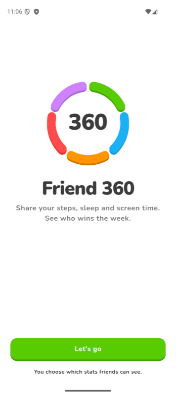
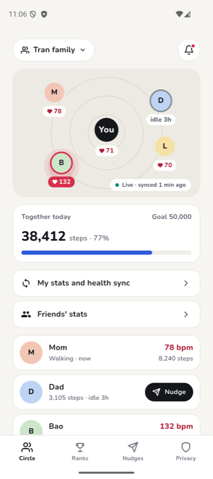
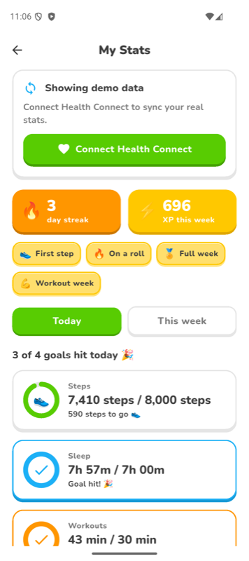
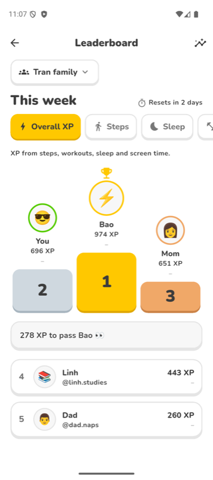
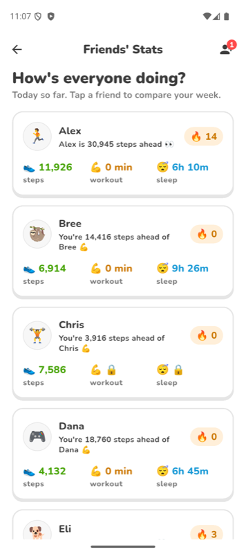
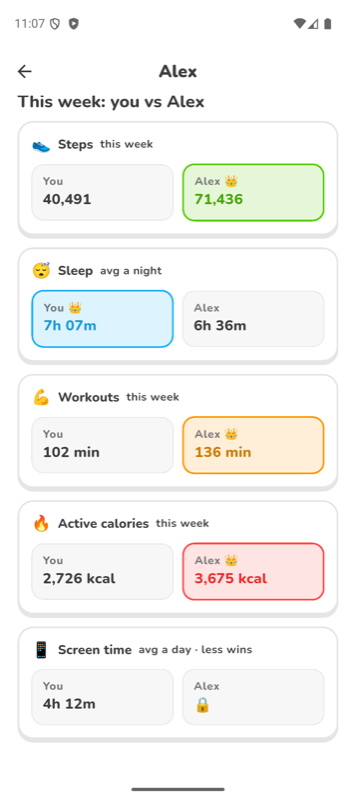
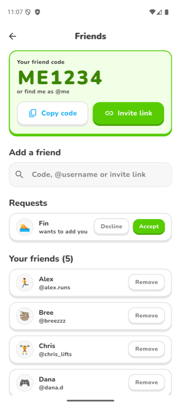
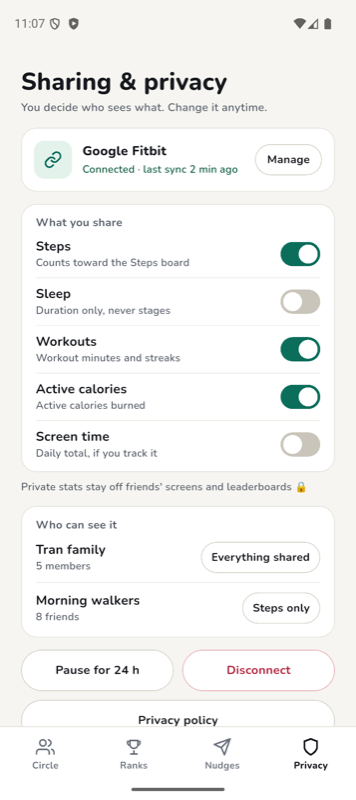

# Friend 360

**Like Life360, but for fitness.** Instead of sharing where you are, you share how you're doing: steps, sleep, workouts, active calories and screen time. Your friends see the stats you choose to share, and everyone races up a weekly leaderboard.

It's meant for friend groups, families and classmates who want light, fun accountability. It should feel like a game, not a clinical health app: XP, streaks 🔥, badges, a podium and a little friendly cheek ("Alex is 2,000 steps ahead 👀").

A CSC 4330 class project, built with Flutter for iOS and Android.

<p>
  
  
  
  
</p>
<p>
  
  
  
  
</p>

## What it does

- **My Stats:** today's progress toward your goals, this week at a glance, your streak, XP and badges.
- **Health sync:** reads steps, sleep, workouts and active calories from **Apple Health** (iPhone, Apple Watch) or **Health Connect** (Android, Pixel Watch, Galaxy Watch, Fitbit). Read only, and only those four.
- **Circles:** a family or group home with everyone's day on one screen, nudges, and group rewards.
- **Leaderboard:** weekly rankings for overall XP, steps, sleep, workouts and screen time, for all your friends or one circle.
- **Friends' Stats:** every friend's day at a glance, and a side-by-side "you vs them" for the week.
- **Friends:** add people by friend code, @username or invite link; accept, decline, cancel and remove.
- **Privacy:** you choose which stats friends can see. Sleep and screen time are private by default, private stats show as 🔒 and stay off the leaderboards, and you can pause sharing for 24 hours. See [PRIVACY.md](PRIVACY.md).

> **Status:** there's no backend yet. Friends, circles and their stats are sample data, and your settings last only while the app is open. Accounts and syncing through Firebase are next ([issue #6](https://github.com/nhitran53/life360/issues/6)).

## Getting started

You need [Flutter](https://docs.flutter.dev/get-started/install) on the **stable** channel (we use 3.47, Dart 3.13 or later).

```bash
git clone https://github.com/nhitran53/life360.git
```

```bash
cd life360
```

```bash
flutter pub get
```

Then start an emulator or simulator and run:

```bash
flutter run
```

### Android

- Android 8.0 (API 26) or later. Health Connect is built into Android 14+; on older versions the app offers to install it.
- To see real numbers on an emulator, add sample steps or sleep with Google's Health Connect Toolbox app, then tap **Connect Health Connect** on My Stats.

### iOS

- iOS 15 or later, built with Xcode on a Mac.
- On the Simulator, open the Health app and add sample data by hand.
- A real iPhone needs the HealthKit capability on your Apple Developer team.

On desktop and web there's no health store, so My Stats shows demo data.

## Checks

Before you open a pull request, run all three. CI runs the same checks on every PR.

```bash
flutter pub get
```

```bash
flutter analyze
```

```bash
flutter test
```

## Project layout

```
lib/
  main.dart          App entry and the animated home screen
  app_services.dart  Creates the repositories once and hands them to screens
  hub_screen.dart    Menu of the main screens
  models/            Plain data: stats, goals, XP, friendships, sharing settings
  data/              Repositories: mock data now, Firebase later
    health/          Apple Health / Health Connect source (package:health)
  screens/           One file per screen
  widgets/           Shared widgets (chunky buttons and cards, avatars, ...)
  theme/             Colors and text styles; every stat keeps one color everywhere
test/                Unit and widget tests, mirroring lib/
docs/screenshots/    The images above
```

Screens only talk to repository interfaces (`StatsRepository`, `FriendsRepository`, `SharingRepository`, ...). The mock versions can be swapped for Firebase without touching the UI.

## Contributing

- Work on a branch such as `feat/<issue#>-short-name` or `fix/<issue#>-short-name`, and open a pull request into `main` that references its issue (`Closes #N`).
- Never push straight to `main`. A teammate reviews and merges.
- Add or update tests when you change a screen.
- Health data is sensitive: never log raw health values, and ask for the smallest set of permissions.

AI coding agents should read [AGENTS.md](AGENTS.md) first. It also covers the design direction and platform gotchas.

## License

[MIT](LICENSE) © 2026 Friend 360 team (CSC 4330)
